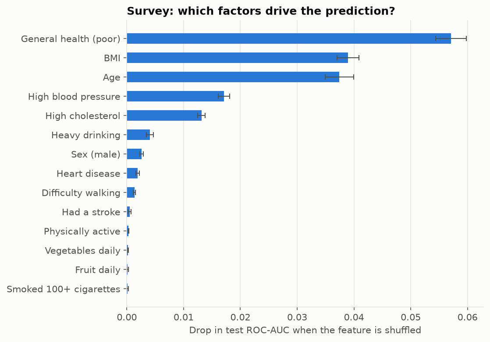
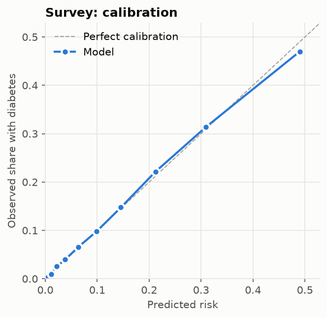
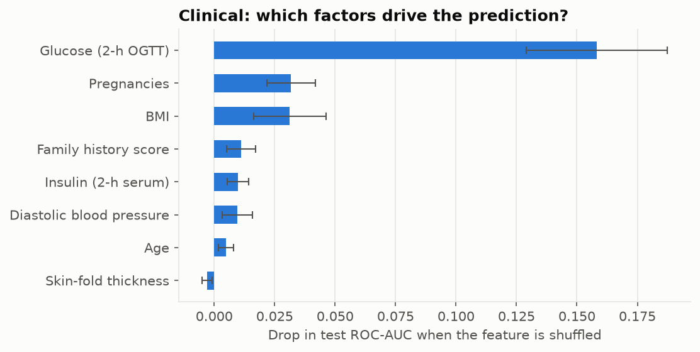
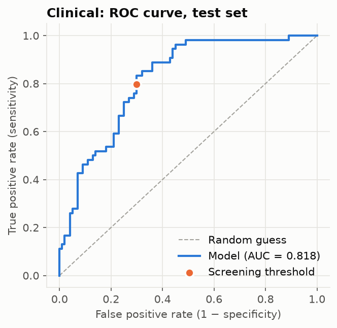

# Diabetes Risk Predictor — SDG 3: Good Health & Well-being

A machine-learning screening tool that estimates a person's risk of diabetes, so
high-risk people can be identified early and referred for a blood test.
**Available in English, हिन्दी and ಕನ್ನಡ.**

It offers two checks:

| | Quick check | Detailed check |
|---|---|---|
| Needs | 14 everyday questions: no lab test | Lab readings, incl. a 2-hour glucose test |
| Built for | Self-checks, ASHA workers, health camps | People who already have lab reports |
| Data | CDC BRFSS survey, 253,680 adults | Pima Indians Diabetes Dataset, 768 women |
| Model | Calibrated Gradient Boosting | Calibrated Logistic Regression |
| Test ROC-AUC | **0.824** | **0.818** |
| Diabetic cases caught | **80%** | **80%** |

## Problem statement
About 101 million Indians have diabetes and another 136 million are prediabetic
(ICMR-INDIAB, 2023). Many are diagnosed late, especially in rural and low-income
areas, because tests cost money and labs are far away. Undiagnosed diabetes leads to
preventable kidney failure, blindness, amputations and heart disease. A quick screen
run by a health worker can decide who needs a confirmatory test first. This supports
**SDG target 3.4**: reduce premature deaths from non-communicable diseases.

## Results
Each model is evaluated **once** on held-out people never used for training, model
selection or threshold tuning.

### Quick check: survey model (50,736 test people)
| Metric | Screening cut-off (13%) | Default 50% cut-off |
|---|---|---|
| **Sensitivity** (diabetics caught) | **79.9%** | 15.3% |
| Specificity (healthy cleared) | 69.8% | 98.1% |
| Accuracy | 71.2% | 86.5% |

The 50% column shows why accuracy misleads: 86.5% sounds good, but always guessing
"no diabetes" already scores 86.1%, and the model would miss **85% of diabetics**.
With the threshold tuned for screening it catches 80%. The probabilities are well
calibrated, and general health, BMI, age, blood pressure and cholesterol matter most.

Leaving out the US-specific questions (income bracket, education level, insurance,
cost of doctor visits) costs only about 0.004 ROC-AUC, so the model transfers better
to Indian users. People who have **never had their blood pressure or cholesterol
checked** can say so: the app then averages the prediction over "yes" and "no",
weighted by how common each is at their age.

### Detailed check: lab model (154 test patients)
| Metric | Screening cut-off (30%) | Default 50% cut-off |
|---|---|---|
| **Sensitivity** | **79.6%** | 53.7% |
| Specificity | 70.0% | 82.0% |
| Accuracy | 73.4% | 72.1% |
| Diabetic cases missed (of 54) | **11** | 25 |

| | |
|---|---|
|  |  |
|  |  |

## How it works
1. **Leakage-free preprocessing**: for the lab model, impossible zeros (glucose,
   BMI and so on) are treated as missing and imputed *inside* the pipeline, so they
   are learned from training folds only.
2. **Model selection**: candidates are compared with stratified k-fold
   cross-validation on ROC-AUC. Four models are compared for the lab data and two
   for the survey data.
3. **Calibration**: probabilities are calibrated (Platt scaling), so a "30% risk"
   means roughly 30 in 100 similar people.
4. **Threshold tuning**: the cut-off is chosen on out-of-fold predictions to catch
   80% of diabetic cases. A false alarm costs one blood test; a missed case can
   cost years of health.
5. **Final models**: each is refit on all data and saved to `artifacts/`.

## The app
- **Three languages**: English, Hindi and Kannada, switchable at the top. Share
  `…/?lang=kn` or `…/?lang=hi` to open it directly in that language.
- **Quick check**: asks height and weight instead of BMI, with "never checked"
  options for blood pressure and cholesterol.
- **Detailed check**: insulin and skin thickness can be left as "not measured",
  and family history is asked in plain words.
- **Explains every result**: a chart shows which answers raise or lower *your* risk.
- **Personalised next steps**, including free government NCD screening for adults
  aged 30+, India-specific BMI advice (23 or more) and the tobacco quitline.
- A **downloadable summary** in the chosen language to show a doctor.

## How to run
```bash
pip install -r requirements.txt
python train.py          # ~3 min: trains both models, saves models + metrics + charts
streamlit run app.py     # opens the web app in your browser
pytest                   # 40 tests: data, models, advice, translations, app end-to-end
```
`python train.py --model clinical` trains one model; `--fast` uses fewer CV folds.

## Project structure
```
diabetes_risk/        reusable package
  config.py           shared paths and the target sensitivity
  clinical.py         lab model: data, pipelines, prediction
  survey.py           no-lab model: data, pipelines, "never checked" handling
  training.py         shared CV / calibration / threshold / evaluation / charts
  advice.py           risk bands, per-person explanations, health tips
  i18n.py             translation helper
locales/              en.json, hi.json, kn.json (all user-facing text)
data/                 pima_diabetes.csv, cdc_brfss_diabetes.csv.gz
train.py              trains both models
app.py                Streamlit web app
tests/                pytest suite (unit, translation consistency, Streamlit AppTest)
artifacts/            trained models + metrics JSON
reports/figures/      evaluation charts
```

**Adding a language**: copy `locales/en.json` to e.g. `ta.json`, translate the values
and add the code to `LANGUAGES` in `diabetes_risk/i18n.py`. The test suite checks that
every key and `{placeholder}` is present.

## Limitations
- **Neither model has been validated on Indian patients.** The survey model learned
  from US adults and the lab model from women of Pima heritage. South Asians develop
  diabetes at lower BMI, so risk may be underestimated. **Re-train and validate on
  local data before any real deployment.**
- The quick check predicts self-reported diabetes *or* prediabetes, and the survey
  has no family-history question.
- The lab model's glucose feature is a 2-hour oral glucose tolerance test, not fasting
  glucose or HbA1c.
- The Hindi and Kannada translations were written with AI assistance and should be
  reviewed by native speakers, ideally health workers.

## Data sources
- CDC Behavioral Risk Factor Surveillance System, via the UCI ML Repository:
  [CDC Diabetes Health Indicators](https://archive.ics.uci.edu/dataset/891/cdc+diabetes+health+indicators)
- Pima Indians Diabetes Dataset (National Institute of Diabetes and Digestive and Kidney Diseases)

## Future scope
- Validate both models on data from Indian hospitals and health camps
- More languages (Tamil, Telugu, Marathi, Bengali) and an offline mobile app for ASHA workers
- Extend to other NCDs (heart disease, hypertension)

*Disclaimer: a screening and awareness tool, not a medical diagnosis.*
